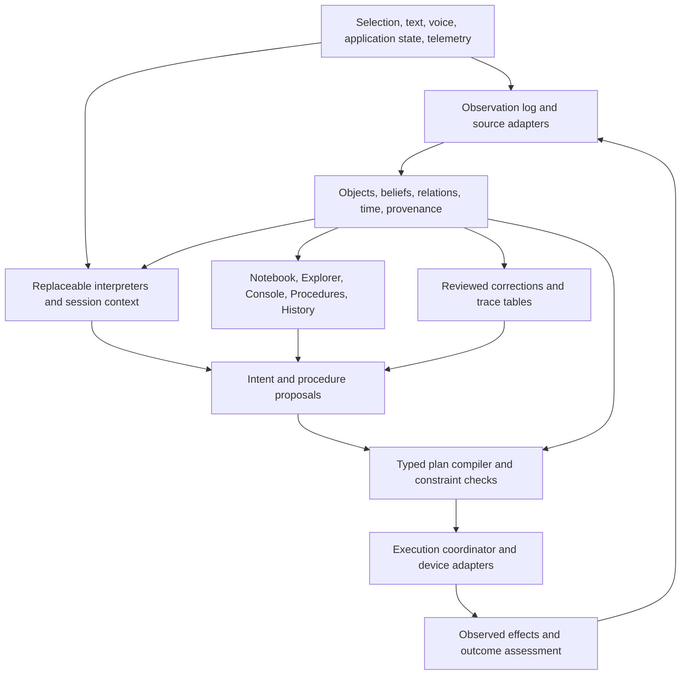

# Physis neurosemantic interface and default applications

Date: 2026-09-14. Status: proposed implementation and research plan.

> Current sequencing and complete-demo acceptance:
> [impossible computer programme](2026-09-19-impossible-computer.md).
> The agentic workspace programme retains market, packaging and Settings gates.
> Settings now includes Runtime, **Memory manager**, **Primitives editor** and
> Appearance. Memory is inspectable, scoped, revisable and exportable; primitives
> have typed drafts, impact previews and versioned apply/rollback. Reuse current
> stores and registered definitions; do not invent a parallel memory engine.
> These additions are planned. Historical Core ownership/connection statements
> below describe the earlier state; current service lives in Pro's `src/ported/`.
> Visual and behavioral contract in the programme supersedes older UI sequencing.

## Immediate priority — a shared system interface, developed with Physis

Latest user direction: build the system interface first so people and agents can
use the computer through a CLI, a folder representation, or another presentation.
The Source Notebook and default application suite remain downstream goals. The
application-first phase ordering below is superseded by this foundational step.

Deliver a reusable workspace interface over existing Physis primitives, with one
versioned response contract for human-readable CLI output and agent JSON. Start
with capability discovery, inspection, file/record lookup, history, explicit
outcome memory, and recorded execution of local programs. Export the same objects
and observation references into an ordinary browsable directory. The first folder
surface is a timestamped snapshot, not a mounted filesystem or a write-triggered
command mechanism. Files remain in their original locations.

Use Physis to implement this layer: recall relevant records, inspect the current
workspace, find/read implementation evidence, run relevant checks through recorded
execution, and remember their actual outcomes. The developer and an agent must
be able to repeat that loop against the same store. Pro recall currently fails
on a missing local development licence; Core navigation works and is the usable
starting point. Do not report the recall wrapper's empty output as success.

First acceptance: use the new interface to locate its own implementation, read
it, run its own focused checks, recall the resulting record, export the records,
and compare CLI/JSON/folder identities. Record the remaining limits explicitly.
Machine-specific execution contracts, broad natural language, GUI applications,
and live filesystem mounting follow this working base.

Native features to build on the base include evidence attached to every result,
source/interpretation history, competing claims, explicit dependency impact,
typed differences, missing-evidence lists, alternative coordinate/facet lenses,
and a clipboard carrying object references and provenance. Existing primitives
can support these compositions; automatic claim extraction, general semantic
differences, drift alerts, and cross-machine procedure transfer remain separately
measured work. The interface must preserve unknown and unverified states instead
of turning search rankings into judgments.

The intended outcome is a computer interface through which a person can inspect,
understand, teach, and operate software and physical machines using the objects,
language, and procedures of their work. Physis maintains the context connecting
an intention to its execution and observed outcome. It should provide useful
LLM-like interaction without requiring a generative LLM in its ordinary operating
loop, and ship a suite of applications composed from its own primitives.

The user's Notebook example means a **NotebookLM-like source workspace**: collect
sources, ask questions about them, inspect cited answers, and save derived material.
This is the first default application. Pro's existing widget dashboard is useful
composition infrastructure, but it is not the specification for this Notebook.

This document plans that outcome. It does not claim the complete system exists,
authorize hardware operation, or report new experimental results.

The concrete worker-pool and Cline/OpenCode integration plan is in
[Agent delegation through Physis](2026-09-14-agent-delegation.md). It is a
dependency of the shared system interface, not a replacement for the Source
Notebook or the later machine console.

## 1. Product thesis and boundaries

Physis provides a coordinate system for meaning, operations over those
coordinates, and applications built from the operations. The default domain pack
has five domains and fourteen modes, with nested facets. The domain list is
configurable in the current Pro grid implementation. Neither the domain count
nor the mode count is a demonstrated universal law.

The six operations remain the architectural vocabulary:

| Operation | Role in the interface |
|---|---|
| Assign | Interpret an observation, object, or request; propose coordinates and alternatives. |
| Find failures | Expose missing concepts, unsupported requests, missing evidence, and coverage gaps. |
| Map structures | Propose correspondences between procedures, objects, and machine capabilities. |
| Detect drift | Notice changed terminology, conditions, or behavior requiring review. |
| Record and revise | Keep observations, competing interpretations, actions, and outcomes with their history. |
| Select | Retrieve the evidence, tools, views, and candidate actions relevant now. |

The product hypothesis is that these operations can support a shared working
environment: a notebook, a procedure editor, and a machine console can manipulate
the same part, run, observation, and procedure without translating them into
separate application-specific copies.

### What “mimic an LLM” means for this program

The target behaviors are contextual reference, flexible phrasing within supported
work, multi-step requests, useful clarification, procedure reuse, explanations,
and persistent learning from correction. They must be measured separately.

General conversation, unrestricted world knowledge, and arbitrary creative prose
are not established consequences of the grid or the tables. Keep them as longer
term research questions rather than dependencies of the first product.

“Neurosemantic” describes the composition of optional learned perception/language
components with explicit meaning, state, relations, and operations. It does not
require neural inference on every path. Track these configurations separately:

| Configuration | Components | Intended role |
|---|---|---|
| Model-free | Explicit selection, typed controls, lexical retrieval, counted representations, procedures, deterministic checks and rendering | Required reference implementation; complete ordinary workflows through the UI. |
| Small-model assisted | Optional speech recognition, embeddings, or a compact intent/slot model | Improve the input boundary while keeping state and execution outside the model. |
| LLM assisted | Optional structured interpretation or drafting through a replaceable provider | Comparison arm and user-selected assistance; record dependence and cost. |

The non-LLM language path must earn its own coverage. Falling back to an LLM and
calling the combined result “LLM-free” is not an acceptable measurement.

## 2. Existing substrate and what needs joining

Source inspection for this plan used the local Pro head `31eeded` and Core head
`0203b46`, plus their existing uncommitted files. Those hashes alone do not
reproduce the inspected state. Before experiments, record both revisions and a
snapshot/hash of the relevant working changes.

| Area | Inspected source | What the plan can reuse; remaining work |
|---|---|---|
| Observations | [observe.rs](../../physis-core/src/observe.rs) | Observation records, log APIs, and several watchers. Add stable cross-source object identity, freshness, and bounded service integration. |
| Navigation | [world.rs](../../physis-core/src/bin/world.rs), [worldstate.rs](../../physis-core/src/worldstate.rs) | A CLI caller and structural/navigation machinery exist. Extract reusable query services where needed instead of embedding CLI calls in applications. |
| Shared beliefs | [ground.rs](../../physis-core/src/ground.rs), [hypothesis.rs](../../physis-core/src/hypothesis.rs), [epistemic.rs](../../physis-core/src/epistemic.rs), [temporal.rs](../../physis-core/src/temporal.rs) | Shared-state views and belief/history primitives. Establish the running observer-to-revision-to-reader contract. |
| Process semantics | [process.rs](../../physis-core/src/process.rs) | Goals, plans, tasks, constraints, states, measurements, and outcomes. Extend these rather than inventing parallel process types. |
| Symbolic structures | [transform.rs](../../physis-core/src/transform.rs) | Contains an existing symbolic `WorldState`. Distinguish it from live device state and navigation projections; do not create a competing authoritative world model. |
| Action history | [act.rs](../../physis-core/src/act.rs) | Records intent and command outcome; bearing selection has CLI callers. Its `sh -c` runner is not the typed physical-machine executor proposed here. |
| Industrial I/O | [industrial.rs](../../src/industrial.rs), [moonraker_connect.rs](../../src/moonraker_connect.rs) | Adapter polling and connector paths; `MachineAdapter::publish` is a low-level write interface. A checked intent-to-command-to-observation loop remains integration work. |
| Language front door | [nlq.rs](../../physis-core/src/nlq.rs) | Proposal/evidence contract and a documented failed held-out cue-parser experiment. Retain that baseline; develop and measure other interpreters. |
| Local tables | [ngram_table.rs](../../physis-core/src/ngram_table.rs), [main.rs](../../physis-core/src/main.rs) | `CellTables` and a document-fed CLI caller exist. Full operational-trace training, facet backoff, and demonstrated action usefulness are separate work. |
| Pro dashboard notebooks | [notebook.rs](../../src/notebook.rs), [web/notebook.rs](../../src/web/notebook.rs) | Registry-backed widget layouts, validation, and HTTP handlers. Reuse suitable renderers/validation patterns; preserve existing dashboard documents as a separate type. |
| Core source notebook | [notebook.rs](../../physis-core/src/notebook.rs) | Corpus answers, sources, table-assisted drafts, and a CLI caller. This is the closest existing engine to the requested NotebookLM-like app. Add source collections, persistent citations, conversations, and saved artifacts. |

Call-site checks found non-test references for `build_cell_tables`, `run_adapter`,
and `bearing_on_with`. This is integration evidence from source, not a fresh
runtime verification of those features. Existing notebook handlers and CLI
dispatch were also inspected. Existing research findings are recorded in
[WHAT_WE_KNOW.md](../WHAT_WE_KNOW.md), [the WorldState program](2026-09-14-worldstate-program.md),
and Core research reports. Their benchmarks were not rerun for this document.

This plan continues [the earlier neurosemantic next steps](2026-09-13-next-steps.md).
It updates two assumptions in older descriptions: per-cell table construction
now has a CLI path, and Pro already has a composable dashboard called a notebook.
Core has the distinct corpus-answer notebook. Keep these names and roles explicit.
This plan leaves the
earlier experimental record intact. New experiments should use `NS-*` identifiers
until assigned a research number, avoiding collisions with existing E-series work.

## 3. First complete experiences

### 3.1 Source Notebook: read, ask, compare, produce

Create a notebook called “Understanding the drive system.” Add a machine manual,
an operator's notes, a maintenance report, and two explicitly identified revisions
of a setup document. The first release supports a bounded set of formats; it
reports extraction failures and leaves unreadable sources visible.

1. Select the sources to use. See which are ready, excluded, missing, or changed.
2. Ask “What changed between the two setups?” Physis retrieves relevant passages
   within the selected sources and builds a comparison with citations.
3. Open a citation and see the exact source revision and supporting passage.
4. Ask “Which of those changes is supported by the maintenance report?” The
   conversation retains the comparison as its referent and checks the selected
   evidence. Unresolved differences remain visible.
5. Save the comparison as a derived artifact. Every factual row retains its
   evidence, selected source set, and producing operation/version.
6. Request a summary, glossary, or procedure draft. The interface identifies
   extractive, structured, and optional generated output and shows evidence gaps.
7. Add a newer report. Existing answers remain tied to their original sources;
   Physis offers a recomputation and displays what changes, instead of silently
   rewriting the previous answer.

This must be useful for an ordinary collection of documents with no machine
connection. Users can ask questions and produce source-based material before
the machine executor or application composer is built.

### 3.2 Machine Console: turn reviewed knowledge into action

Use a simulated variable-speed machine as the first execution target. It exposes
state, speed, a load signal, an outcome metric, connection status, and permitted
operations. The simulator provides repeatable scenarios and faults. Its results
establish software behavior only, not the suitability of a physical intervention.

The operator opens the Machine Console and selects “Test part A.” Its object view
shows the selected simulator, current state, and measurement freshness. The
operator can bring a procedure draft from the Source Notebook into Procedure
Studio, review it, and reference an explicitly accepted run for that part/setup.
An answer or draft from a notebook is not automatically an executable procedure.

1. The operator says or types: “Use the setup that worked last time.”
2. Physis resolves the selected part and machine, retrieves candidate runs, and
   shows which outcome made each one eligible. If more than one interpretation
   remains plausible, the user chooses from concrete alternatives.
3. Physis presents the proposed procedure and differences from current state.
   Parameters retain units, limits, sources, and unresolved fields.
4. The operator changes a condition: “This time keep it below the new limit.”
   The interface identifies the referenced limit or asks for the missing value;
   it does not invent a machine setting from that phrase.
5. The compiler binds the procedure to the simulator's capability version and
   current state. The operator sees and approves the exact executable revision.
6. The executor checks the relevant state again, sends the allowed operation,
   and waits for observations showing its effect.
7. The shared record gains a run: request, interpretation, procedure revision,
   commands, acknowledgements, measurements, and outcome assessment. The user can
   add a versioned run report as a source in the Notebook and ask questions about it.
8. The operator can correct the interpretation, reject the outcome, or save the
   demonstrated procedure. These are three different kinds of feedback.

A restart followed by “why did we choose that?” must recover the same record.
A disconnect after command dispatch must produce an unknown outcome until
reconciled. A stale successful run must not override a newer explicit constraint.

The same experience must remain usable through selection and ordinary controls
when the language interpreter is disabled.

## 4. Architecture and ownership



Core owns reusable semantics, object/reference contracts, interpretation results,
procedure definitions, pure planning/checking logic, temporal projections, and
learning interfaces. Preserve its ability to run without web, device drivers,
or a generative model.

Pro owns the durable service assembly, tenants, device connections, execution
coordination, application registry, and product UI. Keep existing Core CLI
surfaces useful for inspection and reproducible experiments.

Use one authoritative record per concern: raw observations record what a source
reported; epistemic events record interpretation changes; execution records track
commands and reconciliation. Connect them through stable IDs and correlation IDs.
Indexes, navigation graphs, and application views are derived projections. Avoid
requiring two independently updated stores to agree through programmer discipline.

Introduce a narrow service facade over existing modules. Applications call its
typed queries and commands; the facade does not replace the existing modules.
Candidate operations are `resolve_objects`, `read_state`, `query_history`,
`interpret`, `propose_plan`, `validate_plan`, `execute_plan`, and `assess_outcome`.
These names are proposed API vocabulary, not existing exports.

## 5. Shared records and contracts

Extend or wrap existing types after checking serialization and consumers. The
following names describe required concepts; they are not a mandate to add one
module or database table per row.

| Concept | Required content and invariants |
|---|---|
| Object reference | Stable ID, kind, tenant/owner, source bindings, aliases, revision, and optional coordinates/facets. An embedding or path alone is not identity. |
| Observation reference | Source/log ID plus sequence, source timestamp, receive timestamp, source quality, and raw-record reference. A source can report incorrect data. |
| State view | Object ID, typed properties and units, field-level evidence, valid/recorded time, freshness, and revision. Unknown is distinct from zero, false, and absent. |
| Session context | Explicit selection, focus, active goal, recent referents, pending clarification, and proposed plan revision. Scoped to the user and session. |
| Intent proposal | Operation, resolved/unresolved objects, arguments, requested outcome, constraints, alternatives, evidence, and interpreter identity/version. Scores are not probabilities unless calibrated. |
| Capability definition | Adapter/device identity, operation ID, argument schema, units, bounds, preconditions, expected observations, retry class, and version. |
| Procedure | Versioned steps/dependencies, typed parameters, applicability conditions, constraints, evidence, and author/acceptance status. |
| Executable plan | Fully bound operations, checked object/state/capability revisions, resource ownership, expected observations, timeouts, and plan hash. |
| Execution record | Plan ID/hash, actor, authorization scope, per-step dispatch/ack/effect state, timestamps, observations, and reconciliation status. |
| Outcome assessment | Goal metric and evaluation window, baseline, observations, success/failure/inconclusive status, assessor, and attribution limits. |
| Learning example | Context, alternatives, selected interpretation/procedure, correction or outcome, source IDs, and train/evaluation eligibility. |
| Source collection | Notebook ID, owner, ordered source/version references, inclusion state, extraction/index status, and collection revision. |
| Cited passage | Source and content version, extraction version, passage ID, exact text offsets, and original locator such as page/section when available. |
| Notebook turn | Question, follow-up context, selected source/version set, retrieval configuration, cited answer, gaps, and interpreter/renderer versions. |
| Derived artifact | Summary/comparison/glossary/procedure draft, evidence bindings, source snapshot, producing operation, edit history, and review status. |

Record capabilities explicitly. A grid coordinate helps find a relevant action;
it does not confer permission or prove physical applicability. Replacing the
domain pack must not change the meaning of a motor register or its allowed range.

Treat object alias merging as a reviewable operation. A rename should preserve
identity; two machines with the same display name should remain distinct. Record
object deletion or revocation without quietly reassigning its ID to a replacement.

## 6. Language, reasoning, and response without an LLM

### 6.1 Reduce ambiguity using the interface

Resolve explicit selections and typed references first. “This,” “there,” and
“again” refer to a visible session state, not the top result in global retrieval.
Display the selected object and interpreted action before a mutating operation.
Changing the selection while a proposal is open must invalidate or explicitly
rebind that proposal, never silently redirect execution.

Build one interpreter contract for text, controls, and later speech. Separate
intent selection, entity resolution, argument extraction, units, negation,
conditions, sequence, and scope. A correct verb with the wrong machine is a wrong
parse. Retain several proposals when ambiguity is meaningful.

### 6.2 Develop comparable interpretation paths

1. Keep explicit controls and the current cue parser as reference arms.
2. Add a compositional grammar for supported operations, entities, quantities,
   relative changes, temporal references, conditions, and sequencing.
3. Retrieve previously corrected expressions and procedure descriptions using
   lexical and counted representations; extract typed slots from the utterance
   and session, not by blindly copying the nearest example's arguments.
4. Evaluate an optional compact intent/slot model or semantic embedder under the
   same contract. Measure its added coverage and runtime footprint.
5. Evaluate an optional LLM interpreter on the identical hidden set. This is a
   comparison, not a source of presumed ground truth.

Unknown phrasing produces an explicit gap and a useful clarification. Growing a
cue list to cover a revealed test set is training, not evidence of generalization.

### 6.3 Compose actions through typed procedures

Retrieve candidate procedures using object type, goal, applicability conditions,
and past outcomes. Instantiate parameters, solve declared dependencies, and check
constraints. Start with short acyclic procedures and a bounded search over
registered operations. Expose the search/time limit when no plan is found.

Distinguish “no valid plan among registered capabilities” from “cannot accomplish
this in the world.” Structural analogy can propose a procedure mapping; each
mapped step must satisfy the target capability contract. Similar labels or graph
shape do not establish interchangeable materials, tooling, or machine behavior.

### 6.4 Render explanations from records

Use a response object with status, selected objects, evidence, alternatives,
planned/observed changes, and missing information. Render it as text, cards,
tables, or speech using a small grammatical/template layer.

“I selected run 42 because it used this part revision and met your recorded
finish criterion” requires those records. If only a similarity score selected it,
say that. Table-generated draft text must not invent measurements, citations, or
execution status. Every actionable value must come from a typed source field.

### 6.5 Distinguish three table research questions

| Table | Predicts | Evaluation target |
|---|---|---|
| Word/co-occurrence table | Lexical/contextual relatedness | Retrieval and object/intent candidates on held-out wording. |
| Cell/facet transition table | Likely next region or operation in a work trace | Next-step utility versus flat and shuffled-trace controls. |
| Response realization table | Surface wording of an already structured answer | Readability and faithfulness; no invented fields. |

A positive result for one table is not evidence for the other two. A hierarchy
may improve specificity while reducing support. Implement fallback from detailed
facet to cell to pooled procedure statistics; measure rather than assume its
value. Keep counts, versions, evidence, and minimum-support rules inspectable.

## 7. Procedures, teaching, and learning

Teaching mode captures an explicit episode: initial context, operator steps,
parameter changes, observations, and an ending assessment. Segment by task and
actor; interleaved unrelated events must not become one learned sequence.

The first teaching workflow proposes a procedure for review. Mark constants,
parameters, device-specific details, preconditions, and outcome criteria. Let the
operator compare the proposal with the actual trace and correct it before saving.
Keep the original trace linked to every derived procedure revision.

Build the operational-trace adapter needed by `CellTables`. Reuse observation and
ledger records with stable references; do not turn a free-form log summary into
an asserted command sequence. Use existing coordinates when valid and retain
unassigned steps when they are not. Capture the coordinate pack/version used.

Maintain three distinct feedback channels:

- Interpretation correction: “By setup, I meant the fixture.” Changes language
  examples and object bindings within a declared scope.
- Procedure correction: “Wait for the measurement before the next step.” Changes
  a reviewed procedure revision and its dependencies.
- Outcome evidence: “The finish failed inspection.” Updates the applicability
  evidence for that run; it does not prove which parameter caused the failure.

Do not learn user preference from a timeout or mark a plan successful because the
adapter returned success. Capture inconclusive outcomes and confounding changes.
Learning produces proposals; reviewed applicability conditions and machine
constraints remain authoritative. Update candidate tables in shadow mode, compare
with the active version, and retain rollback to the previous learned artifact.

Cross-machine transfer comes later: match capability contracts, units, resource
requirements, and expected effects; then compare mapped procedures in simulation.
Demonstrate transfer on a held-out device schema before making a transfer claim.

## 8. Machine execution and feedback

The product executes registered typed operations. An interpreter never supplies
arbitrary shell text, G-code, topic names, register addresses, or URLs directly to
the executor. Device-specific encoding lives in reviewed adapters. Existing raw
command tools can remain explicit expert tools outside this path.

Execution lifecycle:

```text
proposed → validated → authorized → dispatching → acknowledged
                                                    ↓
                                         observing → assessed

Any stage may become blocked or failed.
Dispatch without a known result becomes unknown → reconciliation.
Cancellation is requested and then observed; it is not assumed immediate.
```

Validation must check argument types, units, limits, freshness, capability
version, applicable hard constraints, and current resource ownership. Authorization
binds to the exact plan revision and permitted operations. At execution, reread
the state fields the validation depended on; relevant changes require revalidation
and, where the plan changes, renewed authorization. A version check alone cannot
make a physical environment atomic, so critical conditions also belong in the
device/controller contract.

Persist intent before dispatch. Correlate retries and acknowledgements. Classify
operations as idempotent, deduplicated by a supported device key, or non-retryable
until reconciled. Do not promise exactly-once delivery across an unreliable device
link. After restart or timeout, determine observed state before retrying a physical
effect. Store acknowledgement and observed completion separately.

Use explicit expected observations and time windows to assess effects. A successful
transport write means accepted by transport; it does not mean the machine achieved
the requested goal. Unsupported observation/verification must remain visible.

Serialize conflicting operations on the same resource using executor ownership
and, where supported, fencing tokens. Reconcile external/manual changes. A command
from another interface can invalidate the local plan even if this executor has
not issued a competing command.

Start with simulator execution, then a device-specific bounded physical pilot.
The machine controller retains its interlocks and real-time control loops. Physis
is a supervisory interface; semantic interpretation is not an emergency-stop or
hard-real-time mechanism. Undo is offered only for effects that the adapter can
actually reverse. Otherwise show a compensating operation or a manual recovery
procedure and verify its result.

## 9. Default applications composed from Physis

### 9.1 Application model

Yes: the default suite should be built from Physis itself. An application combines
a named purpose, object/query bindings, registered view blocks, declared actions,
and a layout. It shares services and records with every other application.

Compose applications at both the service and UI levels. The Source Notebook
assembles ingestion, retrieval, relations, source-grounded answers, and provenance.
The Console assembles state, capabilities, plans, execution, and measurement. They
can reuse renderers without having the same layout or interaction model.

Pro's dashboard notebooks already represent layout cells as widget IDs plus
parameters. Reuse suitable registry/validation patterns and renderers, but give
the Source Notebook its own collection/conversation/artifact model. Preserve the
existing dashboard format and routes; avoid silently interpreting saved dashboard
documents as source notebooks. Never confuse layout cells with semiotic grid cells.

Required reusable blocks:

| Block | Shared function |
|---|---|
| Object card | Identity, kind, current state, freshness, and available operations. |
| Note/source block | Authored text or referenced source with author, revision, and citations. |
| Query/result block | Saved typed query; live results or a pinned historical result. |
| Evidence block | Claims, supporting and contradicting observations, and unresolved questions. |
| Timeline/difference block | State, belief, procedure, or run changes with provenance. |
| Measurement block | Typed values, units, time window, missing samples, and outcome criteria. |
| Procedure block | Steps, dependencies, parameters, applicability, and revision. |
| Action preview block | Exact bound proposal, checks, expected effects, and execution status. |
| Answer block | Core notebook results/drafts, source references, and visible gaps. |

Ship a registry of trusted block implementations. Saved layouts refer only to
registered IDs and validated parameter schemas; they carry no executable HTML,
JavaScript, arbitrary endpoint, or automatic command on load. A block can request
an action through the shared executor, but opening, importing, refreshing, or
rendering an application never authorizes it.

Proposed application definition fields are `id`, `schema_version`, `title`,
`purpose`, `bindings`, `views`, `allowed_action_ids`, and `layout`. Keep display
preferences separate from shared domain records. A manifest's allowed actions
restrict the UI; server-side authorization remains authoritative. Validate schema
versions and migrations, unresolved bindings, and ownership on import.

### 9.2 Starter suite and delivery order

| Application | What the person does | Composition | Delivery |
|---|---|---|---|
| Source Notebook | Collect and select sources, ask follow-up questions, inspect citations, save source-based summaries/comparisons/drafts | Source library, conversation, citation reader, artifact workspace; shared ingest/retrieval/epistemic services | First app and integration proof; useful without machines. |
| Machine Console | Inspect machine state, adjust typed parameters, preview and run procedures | Object, measurement, action preview, timeline blocks | First simulator workflow; later physical pilot. |
| Explorer | Find a part, file, run, device, or claim by relation, history, and purpose | Object list, query, relation neighborhood, timeline | Reuse world navigation; follow the first shared object contract. |
| Procedure Studio | Teach, inspect, parameterize, compare, and test reusable procedures | Trace, procedure, difference, action preview blocks | After execution records and teaching episodes exist. |
| History and Evidence | Answer what changed, what was believed, and why an action happened | Timeline, evidence, difference, source blocks | Basic blocks in the first app; dedicated workspace later. |
| Workbench | Arrange several applications around a part, project, or goal | Shared selection, saved workspace, linked app panels | After the first two apps demonstrate shared state. |

Do not build six separate backends or independently maintained copies of a run.
Creating the second application must reuse the first one's object identity,
query, provenance, and action contracts. If it cannot, repair the seam before
adding applications.

### 9.3 Source Notebook: detailed application specification

Build around Core's corpus answer/draft module. Reuse Pro's ingestion and web
infrastructure after verifying its format coverage and tenant behavior. The
primary interaction is a source-based conversation with inspectable evidence.

The default layout has a source library on the left, conversation in the center,
and a reader/artifact workspace on the right. Narrow screens switch between those
three views. Source inclusion remains visible next to the question input. Clicking
a citation opens its passage, not a generic search or the newest document revision.

**Source library.** Create/rename a notebook; add and remove sources from its
collection; select which sources a question may use. Start with text, Markdown,
and text-bearing PDF after extractor verification. Track queued, extracting,
indexing, ready, partial, and failed states. Display size/page limits and partial
coverage. Scanned PDFs/OCR, authenticated URLs, audio, and video are subsequent
format adapters, not implied first-release support.

**Ingestion.** Preserve source identity, content hash/version, extractor version,
document structure, and passage boundaries. Retain page/section locators where the
extractor supplies them. A derived passage must resolve back to the preserved
source version or explicitly report that the source is unavailable. Deduplicate
content without erasing separate source attributions. Reindex a changed source as
a new version and keep conversations bound to their original version set.

**Question answering.** Select sources first, then retrieve within that permitted
set. Parse supported question forms and resolve follow-ups against the conversation
and its cited objects. Retrieve with lexical and optional semantic arms, select
evidence under a budget, and emit a structured answer with passage bindings and
unanswered subquestions. A selected source is eligible evidence, not guaranteed
coverage. Display which selected sources were actually used.

**Evidence handling.** Separate direct extraction, source-attributed claims,
comparisons, and derived inferences. If two sources disagree, show the two cited
claims and their dates/scopes; do not assume the newest is authoritative in every
domain. Source corrections/supersession need explicit relationships. A citation
that exists does not by itself prove the sentence it is attached to, so measure
support as well as locator validity.

**Outputs without a generative LLM.** First provide relevant passages with short
structured answers, extractive summaries, source-attributed comparison tables,
glossaries extracted from explicit definitions, timelines from explicit dates,
and procedure drafts assembled from identified steps. Use templates or bounded
grammatical realization over evidence. Label gaps. Concept maps and contradiction
lists depend on measured relation extraction; display inferred links as proposals.
Arbitrary fluent synthesis across a broad corpus is NOT MEASURED. Table-assisted
drafting is an experimental arm until its output is useful and faithful on held-out
questions; it must not be used to disguise retrieval excerpts as general reasoning.

**Artifact workspace.** Save an answer, comparison, summary, or draft independently
of its conversation position. Keep its source snapshot, citations, producing
operation, and edit history. Distinguish user-authored additions from source-backed
content. Export readable Markdown/HTML plus a structured JSON representation with
source references. Never treat a previous generated artifact as independent
corroboration of the sources from which it was produced; lineage must prevent
self-citation loops from inflating evidence.

**Updates.** When sources change, indicate which saved outputs may be stale and
offer an explicit recomputation. Preserve the previous output and show a difference.
Removing a source from the active collection excludes it from future retrieval;
deleting retained source content makes historical citations visibly unresolved.
Conversation carryover must not smuggle excluded source facts into a new answer.

**Connection to machines.** A machine run report or accepted procedure can become
a versioned notebook source. The user can compare outcomes or draft a procedure
from manuals and previous runs. Moving that draft to Procedure Studio preserves
citations but requires explicit parameter binding and review before it becomes
executable. Machine operation happens through the Console/executor contract.

**Scope discipline.** Typed selection, ask, cite, compare, and save come first.
Long-form generative reports, narrated overviews, and richer media are later
features with their own quality/dependency gates. The user should receive a
useful source notebook while broader language generation remains a research task.

### 9.4 User-built applications

After the starter suite works, add a composer: select objects, choose registered
blocks, bind inputs, arrange the layout, and save a named application. Begin with
finite layouts and typed bindings. Include import/export, validation errors,
version migration, and previews showing required data and capabilities.

Natural language may propose an application manifest later. Validate and preview
it using the same path as manual composition. This gives a bounded interpretation
of “make me an application”: compose existing capabilities around shared objects.
Adding new executable capabilities remains extension development, with its own
adapter contract and review. Automatic invention of arbitrary working software is
NOT MEASURED and is not a prerequisite for the suite.

## 10. Storage, services, and operational limits

Use the existing persistence and tenant infrastructure where it satisfies the
contracts. Inventory existing stores before changing ownership. Version events
and projections; migrate additively, and verify older notebook/graph documents
still load. Build a restart fixture before adding a background learner.

Sources retain their own identifiers; use a correlation record to connect a file,
part, machine, and run. Historical measurements and valid-time facts are separate
from current best estimates. New conflicting telemetry should create a visible
uncertainty rather than silently overwriting an asserted fact.

Treat external documents and observed text as data. They may describe a command
or claim an instruction, but they cannot create authorization. Device credentials
stay in adapter configuration, never exported application layouts or notes.
Bind tenant identity to authenticated server context for multi-user deployment;
do not treat an arbitrary caller-supplied user header as proof of identity.

Scope observation to the workspace/device sources the operator selected. Include
capture controls, exclusions, bounded queues, and clear offline/stale states.
Append-only describes ordinary event semantics; specify retention, archive, and
explicit user deletion procedures rather than promising infinite storage. Deleted
content needs invalidated indexes and visible unresolved historical references.

Provisional engineering budgets, to freeze against a named reference machine in
Phase 0: warm selection/state display p95 under 200 ms, simple local interpretation
and preview p95 under 500 ms, notebook initial display under 2 s on the reference
fixture, and idle observation under 10% of one CPU core and 500 MB RSS over 24 h.
Report corpus size, device count, sample rate, warm/cold state, and optional-model
memory separately. These are targets, not measurements or device deadlines.

Replace full-world recomputation with incremental projections when measurements
justify it. Test at 10k and 100k observations before promising a larger scale.
Bound history queries, result payloads, graph expansion, and event backlogs; show
partial or delayed results explicitly.

## 11. Evaluation program

### 11.1 Freeze tasks before tuning

Create a versioned task manifest with input, initial world state, supported
capabilities, expected object/intent/arguments, permitted outcomes, and ambiguity
labels. Keep train, development, and hidden evaluation sets separate by procedure
family and session; reserve unseen operator phrasing and a later device schema.
Near-duplicate traces must not cross the split.

Start with 200 interpretation cases and 50 complete simulator scenarios. Those
counts are proposed engineering fixtures, not statistical guarantees. Include
unseen paraphrases, negation, same-name devices, omitted units, incompatible units,
relative changes, multiple clauses, pronouns, stale state, conflicting evidence,
retracted procedures, and unsupported requests. Use separate authors or a frozen
external review for hidden questions where possible; do not fit and grade with
the same evolving phrase list.

For the Source Notebook, add 120 questions across at least 12 source collections
covering four kinds of work, including non-industrial documents. Split entire
collections rather than nearby passages. Include answerable and unanswerable
questions, conflicting claims, multi-source comparisons, follow-ups, excluded
sources, source revisions, failed extraction, and derived-artifact self-citation.
Annotate supporting passages and acceptable answers independently of the retrieval
implementation. Compare ordinary search with the structured notebook on operator
task completion as well as answer quality.

### 11.2 Named experiments and controls

| ID | Question | Controls and measured outcome |
|---|---|---|
| NS-01 | Does contextual selection help interpretation? | Same inputs with/without selection; exact object, intent, slots, and user correction count. |
| NS-02 | Does the non-LLM interpreter handle unseen phrasing? | Cue parser, majority intent, explicit form UI, lexical retrieval, optional small model and LLM; precision/coverage, slot errors, clarification quality, latency. |
| NS-03 | Do trace-conditioned tables help? | Flat table, shuffled event order preserving episode boundaries/marginals, last-action and common-procedure baselines; next-step ranking and completed-task utility. |
| NS-04 | Do facets justify their sparsity? | Cell-only, facet-conditioned, and pooled fallback on identical traces; support-stratified scores and held-out procedure families. |
| NS-05 | Does memory improve action choice? | Current state only, retrieved raw history, and structured temporal memory; stale-plan reuse and successful outcomes. |
| NS-06 | Can structure propose transferable procedures? | Nearest text procedure, capability-only matching, explicit manual mapping, and shuffled correspondences; valid mapped steps and simulator task success. |
| NS-07 | Do composed apps improve the workflow? | Existing controls plus ordinary notes versus the Notebook/Console pair; completion, operator time, corrections, and reconstruction of why a choice was made. |
| NS-08 | Do explanations stay faithful? | Check every displayed value, state claim, and citation against immutable records; compare templates with optional table realization. |
| NS-09 | Does a reviewed correction generalize? | Frozen model/table before and after correction; untouched cases, held-out equivalent expressions, regressions, and rollback. |
| NS-10 | Is the Source Notebook useful and faithful without an LLM? | Plain document search/excerpts, template-backed structured answers, table drafts, optional generated answers; evidence recall, answer correctness, citation support, task completion, and unanswered-question handling. |

Measure complete structured intents, not verb accuracy alone. Report abstention
and clarification separately so “refuse everything” cannot pass. Distinguish a
correct clarification on an ambiguous request from an unnecessary interruption
on a fully specified one.

Use paired evaluation, multiple seeds where relevant, confidence intervals, and
per-category denominators. Average over tasks/procedures rather than counting
repeated telemetry samples as independent successes. Freeze primary metrics and
decision thresholds before hidden evaluation. Label inconclusive results as such.

### 11.3 Provisional release gates

These are engineering goals to finalize in Phase 0, not claims about today's code:

- All initial 50 simulator scenarios produce the specified execution state,
  including unknown/reconciled states and correctly blocked invalid plans.
- All machine writes enter through the typed executor and appear in the record.
  No layout load, query refresh, or interpretation call triggers a device write.
- At least 95% exact complete-intent accuracy among accepted, fully specified
  supported inputs, with at least 80% coverage on the hidden in-domain set. Count
  unsupported/ambiguous cases separately and report the full precision/coverage
  curve. These are UI usability targets, not authorization to bypass execution
  checks or a physical-safety claim.
- Every displayed execution outcome and explanation citation resolves to recorded
  evidence in the test fixture; stale/missing evidence is explicitly marked.
- Restart, delayed acknowledgement, disconnect, and external state-change scenarios
  preserve history and do not produce an unreviewed duplicate physical effect.
- The model-free UI completes the same scoped tasks without language input; the
  non-LLM language arm reports its own success independently of optional fallback.
- Notebook and Console use the same object/run/procedure IDs; exported layouts do
  not carry executable content, credentials, or implicit authorization.
- Source Notebook citation locators resolve in every retained-source test case;
  missing/deleted-source cases display that condition. Enforce selected-source
  scope for both retrieval and conversation carryover. A source update never
  silently changes a saved answer.
- For supported notebook question/output types, target at least 95% source-supported
  factual assertions and 80% correct answers on answerable hidden questions, with
  unsupported claims and inappropriate abstentions counted explicitly. Report
  extraction coverage and performance by question type. These provisional targets
  are separate from the machine-intent gate and must be frozen before evaluation.
- A pilot operator can complete the workflow without knowing grid coordinates or
  module names. Measure time and corrections against their current method.

Finite tests do not prove universal correctness. Physical pilot acceptance also
requires a concrete device, allowed operation list, controller constraints, and
recovery procedure reviewed for that device.

## 12. Delivery phases and work packages

Estimates below are active engineering effort for one experienced implementer,
including integration and relevant tests. They are planning ranges, not delivery
promises. Phases 0–2 deliver the source application; Phases 3–4 add the contextual
simulator workflow. The device-specific pilot follows the execution gates. Broader
language and table research must not block either source inspection or the
explicit-control workflow.

### Phase 0 — Baseline and contracts (3–5 working days)

Inventory reachable paths, record the dirty-tree snapshot, map existing stores,
and freeze the first workflow, fixture, capability schema, metrics, and budgets.
Choose the simulator operations and designate physical target selection as a
later pilot decision. Check current tests for relevant primitives.

Deliver: architecture/ownership record, task manifest, serialized contract
examples, current capability matrix, and reproducible baseline commands.
Exit: every claimed existing capability has a named caller or is marked unverified;
each missing seam has an owner and a first consuming feature.

### Phase 1 — Shared objects and source collections (5–8 days)

Implement stable references, field freshness, session selection, historical/live
bindings, and a thin service facade. Add source collections, ingestion status,
versioned passages, source inclusion controls, and a citation reader. Preserve
existing dashboard notebook formats; give source notebooks a distinct schema.

Deliver: a notebook can ingest its supported formats, select sources, search them,
and open passages with persistent references.
Exit: rename, same-name collision, tenant separation, stale state, import, and
restart fixtures pass; unreadable and excluded sources behave explicitly.

### Phase 2 — Source Notebook conversations and artifacts (5–8 days)

Integrate Core notebook answers/drafts into the Source Notebook. Add conversation
records, cited structured answers, supported follow-ups, saved comparisons and
extractive summaries, and source-version handling. Build Section 3.1's workflow.
Run NS-10's baseline and candidate arms; retain visible excerpts when an answer
cannot be supported. Do not require the general action interpreter from Phase 4.

Deliver: the first standalone default application, useful on documents without
any machine connection. Exit: source-scope and citation gates pass, source changes
produce reviewable output revisions, and quality/coverage limits are measured.
If the non-LLM synthesis gate fails, report that milestone as incomplete and keep
the useful source reader/search available; do not label it completed synthesis.

### Phase 3 — Typed simulator and execution lifecycle (7–10 days)

Implement simulator capabilities, a pure plan validator, durable execution state,
timeouts/reconciliation, and observations of expected effects. Build the Machine
Console from shared object, measurement, and action-preview blocks. Export run
reports as versioned sources so the Notebook can inspect the same run IDs.

Deliver: manual UI controls operate the simulator through recorded typed plans.
Exit: nominal and injected-fault scenarios satisfy the execution contract; the
notebook's report and console's execution view resolve to the same run after
restart. Section 3.2 works through explicit controls.

### Phase 4 — Non-LLM contextual interaction (8–12 days)

Implement the interpreter contract, compositional grammar, exemplar retrieval,
typed slot binding, and clarification UI. Integrate session references and
deterministic response rendering. Run NS-01, NS-02, and NS-08 on frozen data.

Deliver: the same workflow accepts supported text, including multi-turn correction.
Exit: interpretation gates pass or the UI clearly exposes a narrower supported
language. A failed language experiment does not invalidate the explicit-control
product; document what remains missing instead of hiding it with fallback.

### Phase 5 — Teaching and local trace learning (8–12 days)

Add teaching episodes, reviewed parameter extraction, procedure revision/diffs,
trace segmentation, and the ledger/observation-to-table adapter. Compare flat,
cell, and facet variants; evaluate reviewed corrections without test leakage.

Deliver: Procedure Studio and reproducible NS-03, NS-04, and NS-09 artifacts.
Exit: teach/reuse is reliable with reviewed procedures. Enable learned suggestions
only where they add measured utility; retain the simpler arm if they do not.

### Phase 6 — Bounded physical-machine pilot (5–10 days plus device access)

Select one actual device with known controller semantics and inspect its API.
Bind capability definitions to its real operations and units. Start read-only,
then exercise a small allowed set under operator supervision. Check telemetry
freshness, manual changes, lost acknowledgement, reconnect, and recovery.

Deliver: the same Notebook/Console workflow on that device, an explicit operating
envelope, and an outcome report. Exit: the device-specific acceptance procedure
passes. A successful simulator run is not a substitute for this gate.

### Phase 7 — Explorer, history, and application composer (8–12 days)

Reuse world queries and shared evidence/timeline blocks. Add saved workspaces,
shared selection across apps, typed block bindings, manifest migrations, and
validated import/export. Test composition without app-specific data copies.

Deliver: the initial default suite and a user-composed application made entirely
from registered blocks. Exit: users can rearrange their workflow without source
edits and without introducing a new backend per layout.

### Phase 8 — Robustness and broader validation (8–12 days)

Run sustained observation/resource tests, larger history fixtures, restore and
migration checks, multi-user isolation, and fault sequences across reconnects.
Recruit additional operators and hold out another procedure/device family. Run
NS-05 through NS-07 where their inputs are available.

Deliver: pilot readiness report with task outcomes, resource usage, failure cases,
and enabled/disabled research features. Exit: measured benefit on actual work,
documented limits, and a supportable recovery path.

Phases 0–2 total approximately 13–21 active working days, or 3–5 working weeks for
the initial Source Notebook, conditional on its bounded answer-quality gate.
Phases 0–4 total approximately 28–43 active working days, or 6–9 working weeks for
the first language-enabled simulator experience. The full initial program totals
approximately 57–89 active working days, or 12–18 working weeks, before delays for
device access, operator studies, or research failures. Re-estimate after Phase 2;
do not schedule later phases as if their research gates were already passed.

### First implementable tickets

| Ticket | Concrete change | Acceptance evidence |
|---|---|---|
| NS-P01 | Snapshot current integration paths and freeze the task manifest | Revision/change hashes and checked baseline commands. |
| NS-P02 | Add versioned object/session binding contracts using existing models | Same-name, rename, and stale-selection fixtures. |
| NS-P03 | Add source collections, ingestion state, passage versions, and the reader | Source inclusion/exclusion, extraction failure, and exact citation location. |
| NS-P04 | Bridge Core notebook answers into source-scoped conversations | Answerable, unanswerable, follow-up, and excluded-source cases. |
| NS-P05 | Add cited comparisons, summaries, and versioned saved artifacts | NS-10 quality/coverage report, source updates, and export lineage. |
| NS-P06 | Define simulator capabilities and typed plan validation | Deterministic effects, units, missing fields, stale state, and version mismatch. |
| NS-P07 | Add durable execution states and linked run reports | Restart/lost-ack behavior; Notebook sources and Console share run IDs. |
| NS-P08 | Add procedure preview and explicit simulator execution UI | Complete Part A workflow and retained evidence after restart. |
| NS-P09 | Add interpreter proposals and clarification against frozen tasks | Exact intent/slots and precision/coverage report. |
| NS-P10 | Capture reviewed teaching episodes and compare table arms | Temporal split, shuffled/flat controls, and documented decision. |

## 13. Decisions, risks, and research branches

| Finding | Decision |
|---|---|
| Context improves language accuracy but unseen wording remains weak | Ship selection plus supported grammar; keep broader wording as a measured interpreter project. |
| A small non-generative model supplies useful extra coverage | Offer it as a bounded input component and disclose its resource/dependency profile. |
| Per-cell tables do not beat pooled statistics | Keep pooled statistics; do not force the grid into a predictive role it has not earned. |
| Procedure analogy fails on a held-out machine | Require explicit capability mapping; keep analogy as a candidate browser. |
| Outcome cannot be attributed to an intervention | Record inconclusive attribution; retain observations and request a controlled comparison. |
| Continuous observation exceeds its budget | Reduce capture scope/rate or use event-driven/on-demand capture, then rerun the budget test. |
| Notebook/Console integration requires duplicated domain state | Fix the shared-service boundary before expanding the suite. |
| Natural-language app generation produces invalid manifests | Keep manual composition and validated templates; measure generation separately. |

Longer term research can explore richer grammar induction, procedure composition
across domains, per-region language realization, and learned application assembly.
Each branch needs held-out inputs, a simpler control, a usefulness metric, and a
rollback path. There is no current proof that combining the six operations yields
general intelligence or a universal language model substitute.

The strongest product claim to earn is concrete: within a defined working world,
Physis lets a person move from intention to a checked action, inspect its effects,
retain what was learned, and compose applications around that same record.

## 14. Plan handoff and verification status

The plan is intended to be implemented as vertical features with live consumers,
not a collection of exported primitives awaiting integration. Every ticket should
name its writer, reader, UI/CLI caller, failure behavior, and acceptance fixture.

This document was prepared from local source and plan inspection. No hardware was
commanded and no benchmarks, builds, or runtime feature tests were performed for
it. Historical results were not promoted into fresh measurements. The repository
recall wrapper produced no visible result; that is an unverified recall attempt,
not evidence that no previous work exists. Source call checks and document/link
checks are the appropriate evidence for this planning change.

During implementation use the repository's recall and outcome-recording workflow,
confirm the store and embedder actually used, and run targeted tests for changed
contracts. Execute required builds/tests on pansa. Record experiment denominators,
controls, source revisions, and unsuccessful findings alongside successful ones.
